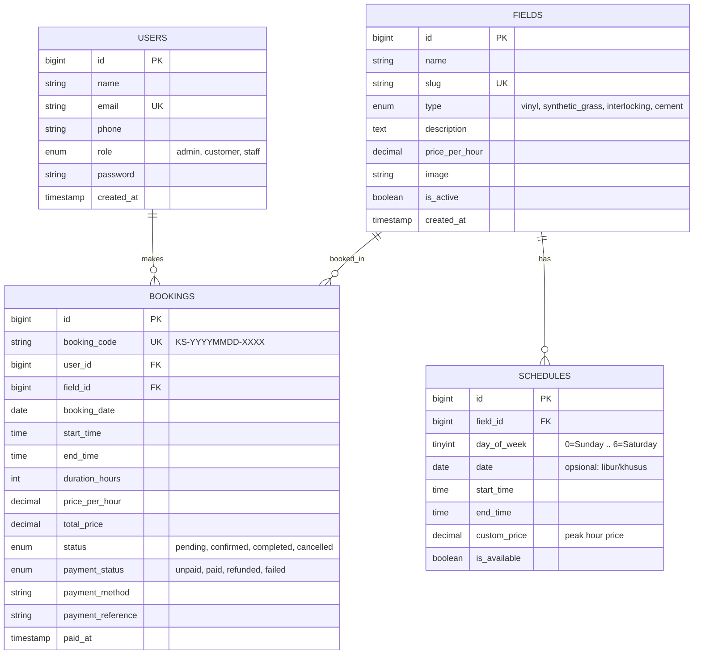
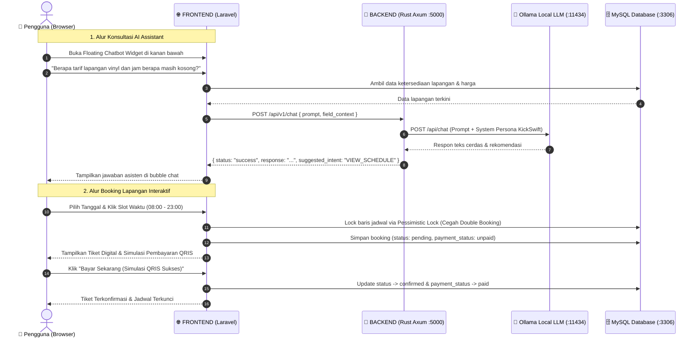

# ⚽ KickSwift - Prototype & MVP Dokumentasi Proyek

KickSwift adalah prototipe aplikasi web pemesanan (booking) lapangan futsal modern berbasis monorepo. Sistem ini menggabungkan keandalan **Laravel (PHP)** sebagai backend monolitik & antarmuka utama pengguna dengan performa tinggi **Rust (Axum)** sebagai microservice AI Chatbot cerdas yang terintegrasi langsung dengan **Ollama LLM**.

---

## 🏗️ 1. Arsitektur Monorepo

Struktur direktori proyek dirancang modular dan terpisah dengan jelas:

```text
KickSwift/
├── FRONTEND/                  # Inti Aplikasi Laravel (PHP 8.3+, Blade, Tailwind CSS, Alpine.js, DB Migrations)
│   ├── app/
│   │   ├── Http/Controllers/  # HomeController, FieldController, BookingController, AiChatController, AuthController, Admin\DashboardController
│   │   ├── Models/            # User, Field, Schedule, Booking
│   │   └── Services/          # BookingService (Concurrency Lock, Slot Matrix), AiChatService (Rust Proxy & Fallback)
│   ├── database/
│   │   ├── migrations/        # Tabel: users, fields, schedules, bookings
│   │   └── seeders/           # Seeder data awal admin, customer, dan 3 varian lapangan
│   ├── resources/views/       # Tampilan UI modern (Layout, Home, Field Detail, Receipt QRIS, History, Admin Dashboard, Auth)
│   ├── routes/
│   │   ├── web.php            # Rute tampilan web & aksi controller
│   │   └── api.php            # Rute REST API publik & terlindungi
│   └── .env                   # Konfigurasi database MySQL & environment
│
├── BACKEND/                   # Layanan Mikro Rust (Axum, Tokio, Ollama Integration)
│   ├── src/
│   │   ├── config.rs          # Konfigurasi environment (Host, Port, Ollama URL, Model)
│   │   ├── handlers/          # Controller HTTP Axum (health check, chat AI)
│   │   ├── models/            # DTO Request & Response
│   │   ├── services/          # Ollama LLM Client & business logic
│   │   └── main.rs            # Entry point, router, middleware CORS & tracing
│   ├── Cargo.toml             # Dependencies Rust
│   ├── Modelfile              # Blueprint kustomisasi persona AI KickSwift di Ollama
│   └── .env                   # Konfigurasi Rust service & Ollama model
│
└── KickSwift.md               # Dokumentasi utama proyek & log perubahan
```

---

## 🗄️ 2. Rancangan Database (MySQL)

Database MySQL `KickSwift` dirancang dengan relasi yang saling terhubung dan terindeks untuk mencegah *double-booking* serta mendukung penetapan tarif dinamis (*peak/off-peak*).



---

## 🔄 3. Alur Komunikasi Layanan (Laravel ↔ Rust ↔ Ollama)



---

## 🔌 4. Dokumentasi Rute & Endpoint

### A. Rute Web (Laravel Interface)
| Method | Rute | Deskripsi | Akses |
| :--- | :--- | :--- | :--- |
| `GET` | `/` | Halaman Landing & Katalog Lapangan Futsal | Publik |
| `GET` | `/fields/{slug}` | Detail Lapangan & Studio Pemilihan Slot Jadwal | Publik |
| `POST` | `/bookings` | Submit reservasi lapangan baru | Customer / Guest |
| `GET` | `/bookings/{code}` | Halaman Tiket Reservasi & Simulasi QRIS | Publik / Pemesan |
| `POST` | `/bookings/{code}/pay` | Eksekusi pembayaran simulasi (Konfirmasi Lunas) | Pemesan |
| `POST` | `/bookings/{code}/cancel`| Pembatalan reservasi yang belum dipakai | Pemesan |
| `GET` | `/my-bookings` | Riwayat seluruh reservasi pengguna | Terautentikasi |
| `POST` | `/ai/chat` | Endpoint AJAX Chatbot Assistant | Publik |
| `GET` | `/admin/dashboard` | Dashboard Operasional & Metrik Pengelola | Khusus Admin |
| `POST` | `/admin/bookings/{code}/status` | Update status booking (Konfirmasi / Selesai) | Khusus Admin |
| `GET` | `/demo/customer` | Login instan 1-klik sebagai Demo Customer | Demo Testing |
| `GET` | `/demo/admin` | Login instan 1-klik sebagai Demo Admin | Demo Testing |

### B. REST API Endpoints (`routes/api.php`)
| Method | Endpoint | Deskripsi |
| :--- | :--- | :--- |
| `GET` | `/api/fields` | Mengambil daftar seluruh lapangan futsal aktif |
| `GET` | `/api/fields/{slug}/slots?date=YYYY-MM-DD` | Mengambil status 15 slot waktu (Tersedia / Terisi) |
| `POST` | `/api/bookings/calculate-price` | Kalkulasi estimasi total biaya (termasuk peak hours) |
| `POST` | `/api/ai/chat` | REST API AI Chatbot dengan konteks database |

### C. Rust AI Microservice (Port: `5000`)
| Method | Endpoint | Deskripsi |
| :--- | :--- | :--- |
| `GET` | `/health` / `/api/v1/health` | Health check mikroservis Rust |
| `POST` | `/api/v1/chat` | Integrasi komunikasi langsung dengan Ollama LLM |

---

## 🚀 5. Panduan Menjalankan & Menguji Prototipe

### 1. Menjalankan Laravel Web Server (`/FRONTEND`)
```bash
cd FRONTEND
php artisan serve
# Web app berjalan di: http://127.0.0.1:8000
```

### 2. Menjalankan Microservice Rust (`/BACKEND`)
```bash
cd BACKEND
cargo run
# Rust AI service berjalan di: http://127.0.0.1:5000
```

### 3. Menggunakan Model Ollama Anda
Model lokal Anda (contoh `qwen2.5:1.5b`) sudah otomatis dikonfigurasikan di `BACKEND/.env`.
```bash
# Pastikan Ollama aktif di latar belakang:
ollama list
```

---

## 🧪 6. Skenario Pengujian Prototipe (End-to-End Walkthrough)

1. **Eksplorasi Katalog**:
   - Buka `http://127.0.0.1:8000`.
   - Coba filter tipe lapangan (*Vinyl Pro*, *Rumput Sintetis*, *Interlocking*).
2. **Uji AI Assistant Chatbot**:
   - Klik ikon pesan mengambang di pojok kanan bawah.
   - Ajukan pertanyaan seperti *"Berapa tarif lapangan vinyl?"* atau klik tombol pertanyaan cepat.
3. **Pemesanan Lapangan (Interactive Slot Picker)**:
   - Pilih lapangan -> Klik **Pilih Jadwal**.
   - Pilih tanggal -> Klik salah satu slot waktu hijau (misal `19:00 - 20:00`).
   - Perhatikan kalkulasi harga otomatis (sudah memperhitungkan tarif *peak hours* malam).
   - Klik **Konfirmasi Booking Sekarang**.
4. **Pembayaran & Verifikasi QRIS**:
   - Di halaman tiket, klik **Bayar Sekarang (Simulasi QRIS Sukses)**.
   - Status langsung berubah menjadi **LUNAS / CONFIRMED** dan slot waktu di lapangan tersebut otomatis berubah menjadi merah (*Terisi/Booked*) jika dicek kembali.
5. **Akses Dashboard Admin**:
   - Klik dropdown role di navbar -> Pilih **Masuk sbg Admin** (atau buka `/admin/dashboard`).
   - Pantau metrik total omset, jumlah booking harian, filter tanggal, dan konfirmasi/check-in pemain di meja kasir.

---

## 📝 7. Changelog & Riwayat Pembaruan

### [Fase 2] - 2026-10-09
- **Service Layer**:
  - `BookingService`: Logika penghitungan ketersediaan slot, pencegahan *race-condition* double booking dengan *Pessimistic Locking*, penghitungan tarif dinamis *peak hours*, dan simulasi pembayaran instan.
  - `AiChatService`: Pengumpul konteks data lapangan dan jembatan ke mikroservis Rust dengan sistem *fallback rule engine* cerdas.
- **Controller & Routing**:
  - `HomeController`, `FieldController`, `BookingController`, `AiChatController`, `Admin\DashboardController`, dan `AuthController`.
  - Pendaftaran 26 rute Web dan REST API.
- **Frontend UI / Blade**:
  - `layouts/app.blade.php`: Desain bertema gelap futuristik (*futsal aesthetic*) dengan Tailwind CSS, Alpine.js, Lucide Icons, notifikasi flash, dan **Floating AI Assistant Chatbot Widget**.
  - `home.blade.php`: Halaman landing interaktif dengan hero, statistik, filter varian lapangan, dan alur booking.
  - `fields/show.blade.php`: Studio pemilihan jadwal visual dengan matriks slot warna (Tersedia, Terisi, Dipilih, Peak Hour) dan kalkulator harga real-time.
  - `bookings/receipt.blade.php`: Halaman tiket digital dengan barcode QRIS simulasi dan tombol konfirmasi instan.
  - `bookings/history.blade.php`: Halaman riwayat reservasi pelanggan.
  - `admin/dashboard.blade.php`: Panel kontrol pengelola futsal dengan metrik omset, filter jadwal harian, dan kontrol check-in.
  - `auth/login.blade.php` & `auth/register.blade.php`: Autentikasi dengan fitur *1-Click Demo Login*.
- **Integrasi Model Kustom Ollama**: Penambahan template `BACKEND/Modelfile` dan konfigurasi environment untuk mendukung model lokal pengguna (`qwen2.5:1.5b`).

### [Fase 1] - 2026-10-09
- Setup struktur monorepo `/FRONTEND` dan `/BACKEND`.
- Pembuatan 4 migrasi database dan Eloquent Model (`users`, `fields`, `schedules`, `bookings`).
- Seeder data awal (Admin, Customer, 3 Lapangan, 315 Slot Jadwal).
- Arsitektur dasar layanan mikro Rust Axum.
- Dokumentasi awal `KickSwift.md`.
